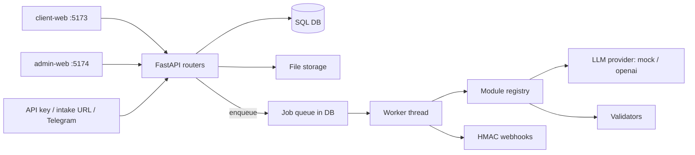

<p align="center">Multi-tenant SaaS for AI document processing and accounting.</p>

<p align="center">
  
  
  
  
  
</p>

Tochno takes invoices, acts, bank statements and ID documents, lets an LLM extract the fields, then checks them with deterministic code (checksums, balances, duplicates, IBAN substitution) before a human approves. It is built for accounting teams and agencies that process documents in bulk and need errors surfaced rather than hidden. Features are enabled per tenant as modules, via a plan or individually from the admin panel.

## Highlights

- **Read, verify, approve:** the LLM only extracts; validation is plain code, and the reviewer sees the original next to the parsed data.
- **Ukrainian-market validators:** EDRPOU / IPN / IBAN checks, duplicate detection, IBAN substitution detection.
- **Modular by design:** a new document type is one file in `app/modules/<module>/types.py` plus a `register(DocType(...))` call.
- **Automation:** auto-approve of clean documents, bulk approve, review pipeline, CSV/XLSX export.
- **Integrations:** API keys (`X-API-Key`), HMAC-signed webhooks, intake URL (email / Zapier / Make), Telegram bot.
- **Multi-tenant platform:** plans and per-tenant modules, audit log, admin impersonation (logged, 30-minute token).

## Architecture



| Component | Role |
|---|---|
| `backend/app/routers` | auth, documents, contractors, knowledge, integrations, settings, admin, meta |
| `backend/app/modules` | `docs_extract`, `reconcile`, `reports`, `identity`, `knowledge` (BM25 RAG assistant) |
| `backend/app/core` | DB-backed job queue and worker, rate limit, storage (local / S3), webhooks, Telegram |
| `frontend/shared` | API client, types, design tokens shared by both apps |
| `landing` | static marketing page |

## Tech stack

| Layer | Technology |
|---|---|
| Backend | Python 3.12, FastAPI, SQLAlchemy 2, Alembic, Pydantic |
| Data | SQLite (dev), PostgreSQL 16 (Docker), local or S3 file storage |
| AI | OpenAI vision (`gpt-4o` default) or a built-in `mock` provider |
| Frontend | React, TypeScript, Vite, npm workspaces |
| Delivery | Docker Compose, nginx, GitHub Actions |

## Quick start

Backend (works without an API key: `LLM_PROVIDER=mock` gives demo recognition):

```bash
cd backend
python -m venv ../.venv && ../.venv/Scripts/pip install -r requirements.txt   # Linux/macOS: ../.venv/bin/pip
cp .env.example .env
../.venv/Scripts/python -m uvicorn app.main:app --reload                       # http://localhost:8000
```

The first platform admin is created on startup from `BOOTSTRAP_ADMIN_*`; if no password is set, a random one is written to the log. Optional demo data: `cd backend && python -m scripts.seed_demo`.

Frontends (from the repo root):

```bash
npm install
npm run dev:client    # client cabinet
npm run dev:admin     # platform admin
```

Full stack in Docker (Postgres, API, client :8080, admin :8081, landing :8082, API :8000):

```bash
cp .env.example .env   # set POSTGRES_PASSWORD and SECRET_KEY
docker compose up -d --build
```

## Configuration

Backend (`backend/.env.example`); the root `.env.example` feeds Docker Compose.

| Variable | Default | Purpose |
|---|---|---|
| `APP_ENV` | `dev` | `prod` requires a non-default `SECRET_KEY` and skips auto schema creation (Alembic runs instead) |
| `SECRET_KEY` | placeholder | JWT signing key (`openssl rand -hex 32`) |
| `DATABASE_URL` | `sqlite:///./tochno.db` | SQLAlchemy URL, or `postgresql+psycopg://...` |
| `STORAGE_DIR` | `./storage` | uploaded files (S3 via `STORAGE_BACKEND=s3` and `S3_*`) |
| `LLM_PROVIDER` | `mock` | `mock` or `openai` |
| `OPENAI_API_KEY` / `OPENAI_VISION_MODEL` | empty / `gpt-4o` | used when provider is `openai` |
| `CORS_ORIGINS` | local dev ports | allowed frontend origins |
| `ALLOW_SIGNUP` | `true` | open self-service registration |
| `BOOTSTRAP_ADMIN_EMAIL` / `_PASSWORD` | `admin@tochno.app` / empty | first platform admin |
| `PUBLIC_API_URL` | empty | public https API URL, needed for the Telegram webhook |
| `POSTGRES_PASSWORD` | none | Docker Compose only |

## Project structure

```
backend/            FastAPI app, Alembic migrations, tests, demo seed
  app/{routers,modules,core}
frontend/
  client-web/       tenant cabinet (React + TS)
  admin-web/        platform admin (React + TS)
  shared/           API client, types, brand
landing/            static landing page
docs/               brand guidelines
docker-compose.yml  full stack
```

## Media

Promo previews: [`brag-output/brag.jpg`](brag-output/brag.jpg), [`brag-output-vertical/brag-vertical.jpg`](brag-output-vertical/brag-vertical.jpg), [`brag-output-tiktok/brag-tiktok.jpg`](brag-output-tiktok/brag-tiktok.jpg). Videos live next to them as `.mp4`.

## Testing and CI

```bash
cd backend && pytest                                                    # SQLite by default
TEST_DATABASE_URL=postgresql+psycopg://... pytest                       # against Postgres
```

41 tests cover the API, modules, features and validators. GitHub Actions (`.github/workflows/ci.yml`) runs `pytest` on Python 3.12 and `npm run build` on Node 22. The frontends have no tests.

## Status and roadmap

Pre-production. Known gaps before a real launch:

- No billing or payments, white-label or SSO.
- Telegram bot token is stored in the DB in plain text; encrypt it (Fernet / KMS).
- Login rate limit is in-memory (single process); move to Redis for multiple instances. No email password reset.
- The job queue and worker run inside the API process; split the worker out under load.
- JWT is kept in `localStorage`; move to httpOnly cookies and put HTTPS / a reverse proxy in front.
- No IMAP mail intake yet (intake URL plus Zapier / Make instead).
- Brand name and trademark availability have not been checked (see `docs/brand-guidelines.md`).
- No LICENSE file is present.

<p align="center"><sub>Built by Vladislav Shmalii, Full-Cycle AI Engineer.</sub></p>
